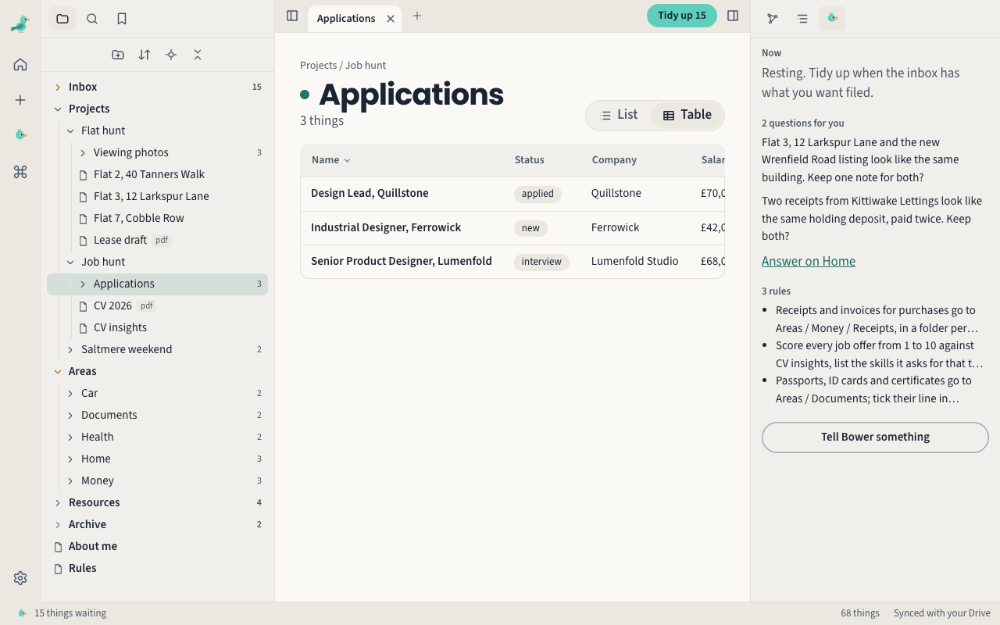
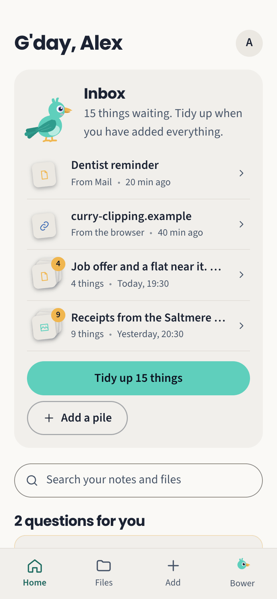
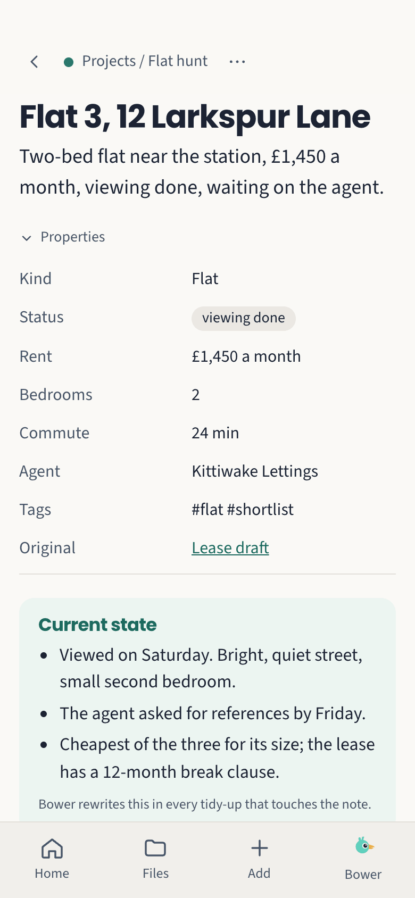
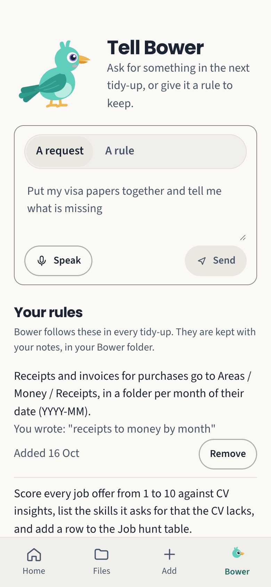
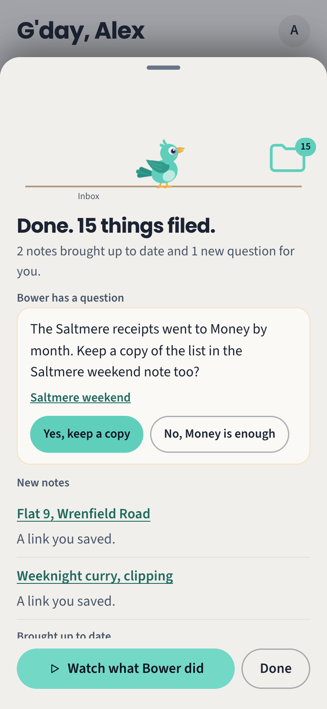
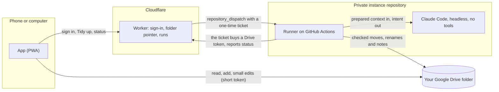
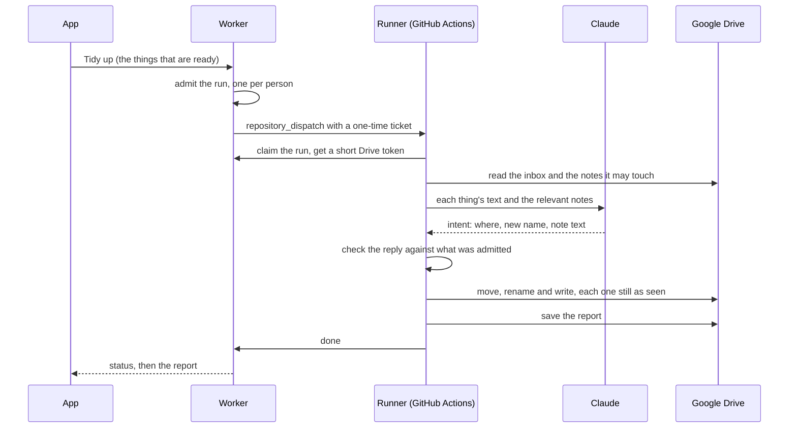
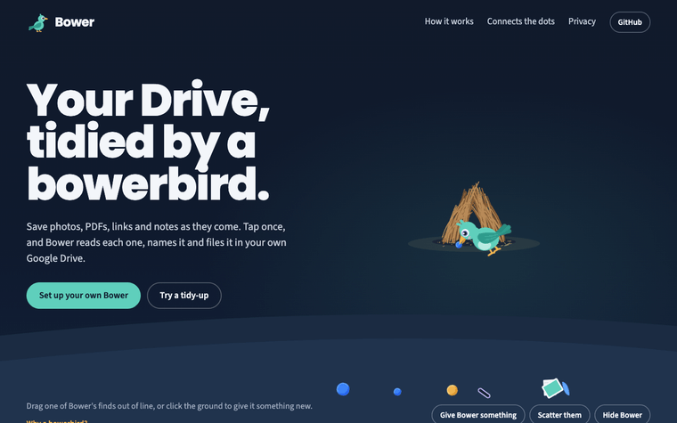

<p align="center">
  
</p>

<h3 align="center">A second brain that tidies itself, in your own Google Drive.</h3>

<p align="center">Throw it all in. Tap once. Bower files each thing, names it and keeps your notes current,<br>
as plain Markdown and the original files, in a folder you own. Claude does the reading; plain code does every write.</p>

<p align="center">
  <a href="#what-a-tidy-up-does">How it works</a> ·
  <a href="#your-things-stay-yours">Privacy and safety</a> ·
  <a href="#run-your-own">Run your own</a> ·
  <a href="#for-developers">For developers</a> ·
  <a href="#how-it-was-built">How it was built</a> ·
  <a href="#faq">FAQ</a>
</p>

<p align="center">
  <a href="https://github.com/deluispablo/bower/actions/workflows/gate.yml"></a>
  <a href="LICENSE"></a>
  <a href="https://claude.com/claude-code"></a>
  
</p>

<table align="center">
  <tr>
    <td align="center" width="50%">
      <picture>
        <source media="(prefers-color-scheme: dark)" srcset="docs/readme/screens/home-desktop-dark.png">
        
      </picture><br><sub>Home: what is waiting, and one button</sub>
    </td>
    <td align="center" width="50%">
      <picture>
        <source media="(prefers-color-scheme: dark)" srcset="docs/readme/screens/note-desktop-dark.png">
        
      </picture><br><sub>A note, with what Bower keeps current</sub>
    </td>
  </tr>
  <tr>
    <td align="center">
      <picture>
        <source media="(prefers-color-scheme: dark)" srcset="docs/readme/screens/table-desktop-dark.png">
        
      </picture><br><sub>A folder of one kind, as a table</sub>
    </td>
    <td align="center">
      <picture>
        <source media="(prefers-color-scheme: dark)" srcset="docs/readme/screens/report-desktop-dark.png">
        
      </picture><br><sub>After a tidy-up: what it did, and one question</sub>
    </td>
  </tr>
</table>

<details>
<summary><b>On a phone</b></summary>
<br>
<table align="center">
  <tr>
    <td align="center">
      <picture>
        <source media="(prefers-color-scheme: dark)" srcset="docs/readme/screens/home-phone-dark.png">
        
      </picture><br><sub>Home</sub>
    </td>
    <td align="center">
      <picture>
        <source media="(prefers-color-scheme: dark)" srcset="docs/readme/screens/note-phone-dark.png">
        
      </picture><br><sub>A note</sub>
    </td>
    <td align="center">
      <picture>
        <source media="(prefers-color-scheme: dark)" srcset="docs/readme/screens/bower-phone-dark.png">
        
      </picture><br><sub>Tell Bower</sub>
    </td>
    <td align="center">
      <picture>
        <source media="(prefers-color-scheme: dark)" srcset="docs/readme/screens/report-phone-dark.png">
        
      </picture><br><sub>Done</sub>
    </td>
  </tr>
</table>
</details>

<p align="center"><sub>The local demo: Alex is made up, and so is everything in the folder. Light or dark follows your GitHub theme. Run it yourself with <code>pnpm dev</code>.</sub></p>

---

## What you get

<table>
  <tr>
    <td width="33%" valign="top"><b>Throw it all in</b><br>Files, photos, links or a line of text, from a phone or a computer. Things that belong together go in one pile with a sentence about them. An upload keeps going if you reload.</td>
    <td width="33%" valign="top"><b>One tap tidies</b><br>Each original moves to the folder your rules name, or where <a href="https://fortelabs.com/blog/para/">PARA</a> says, with a name that says what it is. Nothing runs until you tap.</td>
    <td width="33%" valign="top"><b>Notes that stay current</b><br>A note keeps a <i>Current state</i> Bower rewrites as new things arrive, a timeline of what changed, and links to related notes both ways.</td>
  </tr>
  <tr>
    <td valign="top"><b>Questions, not guesses</b><br>Two listings that look like the same flat, or a receipt that looks paid twice, become a question on Home.</td>
    <td valign="top"><b>Tell Bower</b><br>A request ("put my visa papers together") or a rule ("receipts go to Money, by month"). Rules are kept in your folder, in your words.</td>
    <td valign="top"><b>Plain files, any app</b><br>Markdown and the originals in one Drive folder. Open it in Obsidian, Google Drive or your phone's Files app; Bower picks up what changed.</td>
  </tr>
</table>

An installable app for phone and computer, in light or dark, with Bower the bowerbird on each screen (it keeps still if you ask your device for less motion).

## What a tidy-up does

<p align="center"></p>

1. **You tap Tidy up.** The Worker admits one run and starts it on GitHub Actions. From then on it carries on if you close the app.
2. **The runner reads each thing:** text, Markdown, saved links and PDFs with a text layer, and the notes it may touch.
3. **Claude decides** where each thing goes, what to call it and what the notes should now say. It answers with intent only, as JSON.
4. **Code checks the answer** against the schema and against what the run was given. Anything else stops the plan before a single write.
5. **Code applies it:** moves, renames and note updates, each one checked against what it read. Originals are never copied or deleted.
6. **You get a report:** what was filed, which notes changed and any question Bower has. The report is saved in your folder too.

## Your things stay yours

> [!NOTE]
> Bower is a window onto one folder of your Google Drive. It never hard-deletes anything, and every change it makes checks the file is still as it read it.

| Promise | How the code keeps it |
| --- | --- |
| **Your notes live in your Drive** | Notes are Markdown, originals stay as they were, and Bower's bookkeeping sits in a hidden `.bower/` folder. The Worker keeps your sign-in (the refresh token encrypted), the folder's id and the state of a run, never a note. |
| **Nothing is hard-deleted** | Bower only moves things to the Drive Bin, where you can get them back. |
| **Writes check what they read** | A content write passes the `modifiedTime` it read; a move or rename first checks the name and place are still as seen. Each change carries a stamp, so a retried run never does it twice. |
| **Your words stay yours** | Bower rewrites only the sections it owns. Your own text in a note is never touched. |
| **Claude proposes, code applies** | Claude runs with no tools at all: it cannot read files, run commands or browse. It never picks a path, writes to Drive or says a run succeeded. |
| **It runs on your own GitHub** | Each tidy-up is a workflow in a private repository of whoever runs the Bower, on GitHub's runners or on their own machine. Content is never stored there. |
| **Leaving is clean** | Sign-out forgets what this device kept about you. Deleting your account makes the Worker forget you; your folder and everything in it stay in your Drive. |

## Why a bowerbird

The male bowerbird of Australia and New Guinea spends his days collecting bright things (shells, feathers, flowers, the odd blue bottle cap), lays them out in front of a bower of twigs, sorted by colour, and then shows off the whole arrangement. That is the job Bower does for your notes.

<p align="center"></p>

## How it works

Four parts, each with one job ([`docs/ARCHITECTURE.md`](docs/ARCHITECTURE.md) has the mechanism map: each behaviour has one home in the code).

- **App** (`src/`): every screen, uploads, reading and small edits straight to Drive, the change journal. React 19, Vite, TypeScript, Zustand, Radix and a service worker from `vite-plugin-pwa`.
- **Worker** (`api/`): Google sign-in, the encrypted refresh token, short Drive tokens for the app, the folder pointer, one active run per person, dispatch and recovery. Hono on Cloudflare Workers, with a Durable Object (SQLite) per person.
- **Runner** (`runner/`): one tidy-up. Reads the inbox, extracts text, asks Claude, checks the reply, applies it to Drive and writes the report. Node 24 bundled with esbuild, zod and unpdf, run by a GitHub Actions workflow.
- **Claude**: understands, classifies, connects and drafts, through Claude Code in headless mode (`claude -p --output-format json`) with every tool turned off.



<details>
<summary><b>One tidy-up, step by step</b></summary>



A stalled run is looked up on GitHub and dispatched once more; the runner skips what the folder already holds. Every failure reaches the person as one short sentence, with the details in the log.

</details>

## Run your own

Bower is self-hosted: whoever runs it sets it up once, and the people they invite sign in with Google and get a folder in their own Drive. The full walkthrough, with rotation, deletion, recovery and rollback, is the [runbook](docs/runbook.md).

1. **Accounts.** Cloudflare, a Google Cloud project with an OAuth client, GitHub, and a Claude plan that includes Claude Code.
2. **The Worker.** Create the KV namespace, set the secrets with `wrangler secret put` (Google client, session and encryption keys, a GitHub token scoped to the instance repository) and deploy. The Worker serves the app on the same origin.
3. **The instance repository.** `scripts/new-instance.sh OWNER/NAME <origin>` creates a private repository with the tidy-up workflow and the built runner. Add `CLAUDE_CODE_OAUTH_TOKEN` as its secret and set the `BOWER_PROVIDER` variable to `claude`. To run tidy-ups on a machine of your own, set `BOWER_RUNS_ON` to its runner label, such as `self-hosted`.
4. **Invite people.** Each address goes on the Worker's allowlist; they sign in and Bower builds their folder.

| Piece | Tier | Cost |
| --- | --- | --- |
| Cloudflare Workers, KV and Durable Objects | Free plan | 0 € |
| GitHub Actions | Free minutes of a private repository, or your own machine | 0 € |
| Google Drive | Each person's own storage | 0 € |
| Claude | The Claude plan of whoever runs the Bower, used through Claude Code | Your plan |

## For developers

```bash
pnpm install
pnpm dev            # http://localhost:5190, the demo with Alex's folder
```

```bash
pnpm check          # lint, types, unit tests (app, api, runner), builds, duplication, unused code, dependencies, bundle, landing
pnpm e2e            # the merge gate: pretend Drive on phone and desktop, then the demo on desktop, with axe
pnpm e2e:fake       # the suite on the real logic over a pretend Google Drive
pnpm e2e:demo       # the suite on the demo, phone and desktop
pnpm e2e:full       # all four (fake and demo, phone and desktop), before a backup or deployment
pnpm e2e:pwa        # the built app: manifest, service worker, offline start
pnpm test:affected  # unit tests affected by a change (app, api, runner); base defaults to main
pnpm e2e:affected   # e2e affected by a change, on the pretend Drive
```

**The gate.** Each change runs its failing-first tests, `pnpm test:affected` and `pnpm e2e:affected`. A batch of changes is merged only after `scripts/ci-gate.sh sdd/batch-N` pushes the batch branch (never with force) and the [`gate`](.github/workflows/gate.yml) workflow passes: every step of `pnpm check` as parallel jobs and the end-to-end suites in shards. `scripts/ci-gate.sh --cleanup sdd/batch-N` deletes the branch once it is merged.

<details>
<summary><b>Where the data comes from, and demo situations</b></summary>

Add `?source=` to the address; the choice is kept for the tab.

- `demo` (the default): Alex's folder in memory.
- `fake`: the real logic (Drive folder, change journal, piles, runs) over a pretend Google Drive and a pretend Worker in the browser, seeded with the same folder.
- `real`: Google Drive and the Worker at `VITE_API_URL`. It is the default when that variable is set and there is no `?source=`.

`?scenario=` is `default`, `signed-out`, `first`, `back`, `running`, `empty`, `fail-run`, `slow` or `offline`; `?time=` is `demo` (a tidy-up takes about 25 s), `real` (about 5 min) or `instant`. ⌘⇧D opens the demo panel, which also switches between `demo` and `fake`. `/_bird` shows every pose and flight Bower has.

</details>

<details>
<summary><b>Where things are</b></summary>

```
src/features/   screens             src/data/         sources (demo, fake, real), Drive, journal, contracts
src/app/        the shell           src/bird/         Bower: the drawing, its poses and motion engine
src/ui/         shared parts        public/landing/   the landing page, exported from the design canvas
api/            the Worker          runner/           the tidy-up runner and its workflow
e2e/            end-to-end suites   testing/          fixtures, the synthetic corpus, gate baselines
docs/           product, architecture, runbook, contracts (specs/) and UI specs (design/specs/)
```

Start with [the product](docs/PRODUCT.md), [the architecture](docs/ARCHITECTURE.md) and [the runbook](docs/runbook.md). The rules every change follows are in [`CLAUDE.md`](CLAUDE.md).

</details>

## How it was built

This rebuild of Bower was designed and written by [Claude Code](https://claude.com/claude-code) agents working as an engineering team, under **deluisp-sdd**, a spec-driven method for coding agents by the same author, refined while building Bower.

<p align="center"></p>

| 14 days | 233 | 6,367 | 408 | 68 |
| :---: | :---: | :---: | :---: | :---: |
| from first commit to today (4 to 17 October 2026) | tasks closed under the method | commits | unit test files across app, Worker and runner | end-to-end specs, on phone and desktop, with axe |

- **One coordinator, fresh workers.** The coordinator turns an idea into small tasks, each with observable acceptance, the paths it may change and the checks that prove it. A fresh worker (a Claude Code subagent or Codex) gets only that context, implements it and hands back a result file.
- **A failing test for every line of acceptance.** Before work starts, each acceptance line is pinned by a red test, and a reviewer checks the contract for anything a red does not pin.
- **Independent review and testing.** Medium and high risk work gets a reviewer that did not write it. A tester uses the running app as people would (logic, layout, copy, accessibility) and files findings that become tasks.
- **Hooks enforce what can be enforced.** Workers cannot commit or push, and their changes are checked against the paths their task owns. Only the coordinator merges, one `--no-ff` merge per task, so `git bisect --first-parent` finds the task behind any change.
- **House rules, written down.** No personal data anywhere (Alex and every example are made up), one home per mechanism, research the standard solution first, and errors are never swallowed. See [`CLAUDE.md`](CLAUDE.md).

## The landing page

The landing page in [`public/landing/`](public/landing/) is exported from a design canvas. Bower flies along as you scroll, perching on each section, and every demo on it works.

<p align="center"></p>

## FAQ

<details>
<summary><b>Why Google Drive, and not a folder on my computer?</b></summary>
<br>
Drive is already on most phones and computers, syncs on its own and keeps a Bin. Bower needs nothing installed: the app talks to Drive directly, and a tidy-up runs in the cloud while your phone is in your pocket. Drive's own sync can also keep the folder on your computer, where any Markdown app can open it.
</details>

<details>
<summary><b>How is this different from an AI plugin for my notes app?</b></summary>
<br>
Bower files the originals as well as the notes: the receipt, the lease and the photo end up in the right folder with a clear name, beside the note that mentions them. It works from a phone, with nothing to keep open, and it leaves plain files behind, so you can use it together with Obsidian on the same folder.
</details>

<details>
<summary><b>Why does it ask for access to my whole Drive?</b></summary>
<br>
Bower marks its files with Drive properties and has to see what you add to the folder from other apps. A narrower Google permission would hide those files from it. Bower works in the one folder it made for you.
</details>

<details>
<summary><b>What can it read today?</b></summary>
<br>
Text, Markdown, saved links and PDFs with a text layer. Photos and scanned PDFs are not read yet (text recognition is next), so give them a sentence in a pile and Bower files them by that.
</details>

<details>
<summary><b>What if I edit a note while a tidy-up runs?</b></summary>
<br>
Every write checks the note is still as Bower read it. A note you changed in the meantime is left as you made it, and the next tidy-up reads it again. Drive has no all-or-nothing check, so an edit landing in the same instant as Bower's write is a rare race; it is a known, documented limit.
</details>

<details>
<summary><b>Can I try it without any accounts?</b></summary>
<br>
Yes. <code>pnpm install</code> then <code>pnpm dev</code> opens the demo with Alex's folder, and <code>?source=fake</code> runs the real logic over a pretend Drive, all in your browser.
</details>

<details>
<summary><b>Can other people use my Bower?</b></summary>
<br>
Yes, the people you put on the Worker's allowlist. Each gets a folder in their own Drive. Google asks for verification before an app with full Drive access is opened to the public; until then it shows a warning and caps how many people can sign in.
</details>

<details>
<summary><b>Is there a hosted version?</b></summary>
<br>
No. Bower is self-hosted, so your sign-in, your runs and your model use stay on accounts you control.
</details>

## Contributing

Bower is a portfolio project, built and run by one person. Issues and ideas are welcome; for a larger change, open an issue first. Every change follows [`CLAUDE.md`](CLAUDE.md) and passes `pnpm check` and `pnpm e2e`.

## License

Source available under the [Functional Source License](https://fsl.software/), [FSL-1.1-MIT](LICENSE): use, change and share it for anything but a competing product, and each version becomes MIT two years after its release. The [LICENSE](LICENSE) file is what counts.

## Credits

Built by [deluispablo](https://github.com/deluispablo), with Claude Code doing the typing. Bower is drawn from the satin bowerbird, violet eye and blue bottle cap included, which really does collect, sort and show off.
