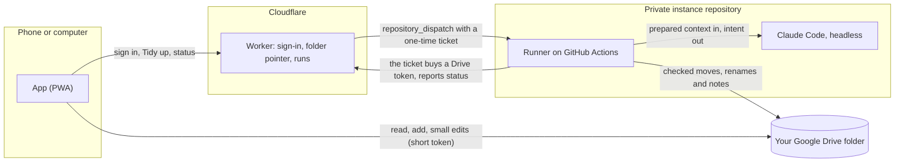
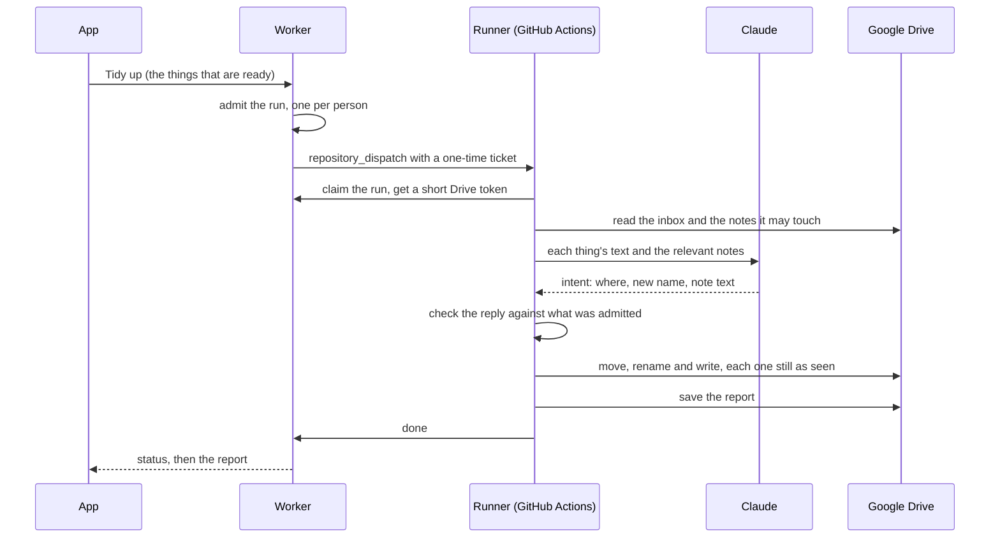

<p align="center">
  
</p>

<p align="center"><b>Throw it all in. Tap once. Bower files it in your own Google Drive.</b><br>
A second brain that lives in plain files you own. Claude does the reading; plain code does every write.</p>

<p align="center">
  <a href="https://github.com/deluispablo/bower/actions/workflows/gate.yml"></a>
  <a href="https://claude.com/claude-code"></a>
  <a href="https://github.com/features/actions"></a>
  <a href="https://workers.cloudflare.com"></a>
  
  
</p>

<table align="center">
  <tr>
    <td align="center" width="50%">
      <picture>
        <source media="(prefers-color-scheme: dark)" srcset="docs/readme/screens/home-desktop-dark.png">
        
      </picture><br><sub>Home: what is waiting, and one button</sub>
    </td>
    <td align="center" width="50%">
      <picture>
        <source media="(prefers-color-scheme: dark)" srcset="docs/readme/screens/note-desktop-dark.png">
        
      </picture><br><sub>A note, with what Bower keeps current</sub>
    </td>
  </tr>
  <tr>
    <td align="center">
      <picture>
        <source media="(prefers-color-scheme: dark)" srcset="docs/readme/screens/table-desktop-dark.png">
        
      </picture><br><sub>A folder of one kind, as a table</sub>
    </td>
    <td align="center">
      <picture>
        <source media="(prefers-color-scheme: dark)" srcset="docs/readme/screens/report-desktop-dark.png">
        
      </picture><br><sub>After a tidy-up: what it did, and one question</sub>
    </td>
  </tr>
</table>

<table align="center">
  <tr>
    <td align="center">
      <picture>
        <source media="(prefers-color-scheme: dark)" srcset="docs/readme/screens/home-phone-dark.png">
        
      </picture><br><sub>Home</sub>
    </td>
    <td align="center">
      <picture>
        <source media="(prefers-color-scheme: dark)" srcset="docs/readme/screens/note-phone-dark.png">
        
      </picture><br><sub>A note</sub>
    </td>
    <td align="center">
      <picture>
        <source media="(prefers-color-scheme: dark)" srcset="docs/readme/screens/bower-phone-dark.png">
        
      </picture><br><sub>Tell Bower</sub>
    </td>
    <td align="center">
      <picture>
        <source media="(prefers-color-scheme: dark)" srcset="docs/readme/screens/report-phone-dark.png">
        
      </picture><br><sub>Done</sub>
    </td>
  </tr>
</table>

<p align="center"><sub>The local demo: Alex is made up, and so is everything in the folder. Light or dark follows your GitHub theme. Run it yourself with <code>pnpm dev</code>.</sub></p>

---

## Why a bowerbird

The bowerbird lives in Australia and New Guinea. The male spends his days collecting bright things (shells, feathers, flowers, the odd blue bottle cap), lays them out in front of a bower of twigs, sorted by colour and size, and then shows off the whole arrangement. No animal is tidier, and he does it all to impress.

That is the job Bower does for your notes. It collects what you throw at it (photos, PDFs, links, half a thought typed on the bus) and keeps it in a folder of **your own Google Drive**, as plain Markdown and the original files. You read it in the app, or in any other app that opens that folder. Bower keeps your sign-in and a pointer to the folder; your notes never live anywhere else.

<p align="center"></p>

## What a tidy-up does

<p align="center"></p>

1. **Add things as they come.** From a phone or a computer: files, a photo, a link, a line of text. Things that belong together go in one pile, with a sentence saying what they are. An upload keeps going if you reload the page.
2. **Tap Tidy up.** Nothing runs behind your back. The tidy-up starts in the cloud and carries on if you close the app.
3. **Bower reads each thing** enough to know what it is: a receipt, a lease, a job offer, a recipe.
4. **It files the original.** It moves it to the folder your rules name, or else where [PARA](https://fortelabs.com/blog/para/) says (a project if it has an end, an area if it goes on, a resource for later, the archive when it is done) and gives it a name that says what it is. `IMG_2290.jpg` becomes `Boiler service, 12 Sep`. Nothing is copied or deleted.
5. **It keeps notes current.** A note gets a *Current state* section that Bower rewrites when new things touch it, a timeline of what changed, and links to related notes.
6. **It asks when it is unsure.** Two listings that look like the same flat, or a receipt that looks paid twice, become a question on Home, not a guess.
7. **It does what you ask.** *Tell Bower* takes a request ("put my visa papers together and tell me what is missing") or a rule ("receipts go to Money, by month"). Rules are kept in your folder, in your words.

## What it is, and what it is not

| | |
| --- | --- |
| **A window onto one Drive folder** | Everything stays in that folder: notes as Markdown, originals as they were, Bower's own bookkeeping in a hidden `.bower/` folder. Delete the app and nothing is lost. |
| **Not a store for your things** | The Worker keeps your sign-in (refresh token encrypted), the folder's id and the state of a run, never a note. A tidy-up works from Drive and keeps nothing once it ends. |
| **Not the only way in** | Open the same folder in Obsidian, Google Drive or your phone's Files app. Bower hides dot folders such as `.obsidian` and picks up what other apps changed at the next tidy-up. |
| **Not a writing app** | You can edit a note in the app, but it is built for reading. Bower never rewrites your own words, only the sections it owns. |
| **Never deletes** | Bower only moves things to the Drive Bin, where you can get them back. |

## The landing page

The landing page in [`public/landing/`](public/landing/) is exported from a design canvas. Bower flies along with you as you scroll, perching on each section, and every demo on it works.

<p align="center"></p>

## How it works

Four parts, each with one job ([`docs/ARCHITECTURE.md`](docs/ARCHITECTURE.md)):

| Part | What it does | Built with |
| --- | --- | --- |
| **App** (`src/`) | Every screen, uploads, the inbox, reading and small edits straight to Drive, the change journal and its outbox | React 19, Vite, TypeScript, React Router, Zustand, Radix, a service worker from `vite-plugin-pwa` |
| **Worker** (`api/`) | Google sign-in, the encrypted refresh token, short Drive tokens for the app, the folder pointer, one active run per person, dispatch, status and recovery | Hono on Cloudflare Workers, a Durable Object per person (SQLite), KV, rate limits, alarms |
| **Runner** (`runner/`) | One tidy-up: reads the inbox, prepares each thing, asks Claude, checks the reply, applies the changes to Drive, writes the report | Node 24 and TypeScript bundled with esbuild, zod, unpdf; a GitHub Actions workflow in a private instance repository |
| **Claude** | Understands, classifies, connects and drafts. It answers with intent only: where each thing goes, its new name, the text of a note | Claude Code in headless mode (`claude -p --output-format json`), no tools, no network, no file access |



### One tidy-up



### The rules the code keeps

- **Claude proposes, code applies.** The model never picks a path, writes to Drive or says a run succeeded. A reply that names something it was not given, or breaks the schema, refuses the plan before any write, and the run says so.
- **Every write checks what it read.** A content write passes the `modifiedTime` it read; a move or rename first checks the name and place are still as seen. Each create, update and move carries a stamp, so a retried run never does a change twice.
- **Originals are kept, deletes go to the Bin.** Bower moves and renames the original and writes its notes beside it. It never hard-deletes, and never touches the person's own words in a note.
- **A run outlives the browser.** Once the Worker admits a run, closing the app changes nothing. A stalled run is looked up on GitHub and dispatched once more; the runner skips what the folder already holds.
- **Errors are said, not swallowed.** Every failure reaches the person as one short sentence, with the details in the log.

## Cost

| Piece | Tier | Cost |
| --- | --- | --- |
| Cloudflare Workers, KV and Durable Objects | Free plan | 0 € |
| GitHub Actions | Free minutes of a private repository | 0 € |
| Google Drive | Each person's own storage | 0 € |
| Claude | The Claude plan of whoever runs the Bower, used through Claude Code | Your plan |

The only thing that can cost money is Claude, and a domain if you want your own.

## Run your own

Bower is self-hosted: whoever runs it sets it up once, and everyone they invite signs in with Google and gets a folder in their own Drive. The walkthrough is the [runbook](docs/runbook.md):

1. **Accounts.** Cloudflare, a Google Cloud project with an OAuth client, GitHub, and a Claude plan that includes Claude Code.
2. **The Worker.** Create the KV namespace, set the secrets with `wrangler secret put` (Google client, session and encryption keys, a GitHub token scoped to the instance repository) and deploy; the Worker serves the app on the same origin.
3. **The instance repository.** `scripts/new-instance.sh OWNER/NAME <origin>` creates a private repository with the tidy-up workflow and the built runner. Add `CLAUDE_CODE_OAUTH_TOKEN` as its secret and set the `BOWER_PROVIDER` variable to `claude` (without it, a tidy-up runs a scripted planner with no model).
4. **Invite people.** Each address goes on the Worker's allowlist; they sign in and Bower builds their folder.

The runbook also covers rotation, deletion, recovery and rollback.

## For developers

```bash
pnpm install
pnpm dev            # http://localhost:5190, the demo with Alex's folder
```

```bash
pnpm check          # lint, types, unit tests (app, api, runner), builds, duplication, unused code, dependencies, bundle, landing
pnpm e2e            # the merge gate: pretend Drive on phone and desktop, then the demo on desktop, with axe
pnpm e2e:fake       # the suite on the real logic over a pretend Google Drive
pnpm e2e:demo       # the suite on the demo, phone and desktop
pnpm e2e:full       # all four (fake and demo, phone and desktop), before a backup or deployment
pnpm e2e:pwa        # the built app: manifest, service worker, offline start
pnpm test:affected  # unit tests affected by a change (app, api, runner); base defaults to main
pnpm e2e:affected   # e2e affected by a change, on the pretend Drive
```

**The gate.** Each change runs `pnpm check` plus the touched screens' end-to-end specs (`pnpm e2e:fake <specs>`). A batch of changes is merged only after `scripts/ci-gate.sh sdd/batch-N` pushes the batch branch (never with force) and the [`gate`](.github/workflows/gate.yml) workflow passes: every step of `pnpm check` as parallel jobs and the end-to-end suites in shards. `scripts/ci-gate.sh --cleanup sdd/batch-N` deletes the branch after it is merged. After a failure, rerun the failing suite with `--last-failed` before the whole gate. Heavy runs share one lock (`testing/with-lock.sh`).

**Where the data comes from.** Add `?source=` to the address; the choice is kept for the tab.

- `demo` (the default): Alex's folder in memory.
- `fake`: the real logic (Drive folder, change journal, piles, runs) over a pretend Google Drive and a pretend Worker in the browser, seeded with the same folder.
- `real`: Google Drive and the Worker at `VITE_API_URL`. It is the default when that variable is set and there is no `?source=`.

**Demo situations.** `?scenario=` is `default`, `signed-out`, `first`, `back`, `running`, `empty`, `fail-run`, `slow` or `offline`; `?time=` is `demo` (a tidy-up takes about 25 s), `real` (about 5 min) or `instant`. ⌘⇧D opens the demo panel, which also switches between `demo` and `fake`. Every situation works on both; the sample piles in the demo panel are only on `demo`. `/_bird` shows every pose and flight Bower has.

**Where things are.**

```
src/features/   screens             src/data/         sources (demo, fake, real), Drive, journal, contracts
src/app/        the shell           src/bird/         Bower: the drawing, its poses and motion engine
src/ui/         shared parts        public/landing/   the landing page, exported from the design canvas
api/            the Worker          runner/           the tidy-up runner and its workflow
e2e/            end-to-end suites   testing/          fixtures, the synthetic corpus, gate baselines
docs/           product, architecture, runbook, contracts (specs/) and UI specs (design/specs/)
```

Start with [the product](docs/PRODUCT.md), [the architecture](docs/ARCHITECTURE.md) and its mechanism map (each behaviour has one home in the code), and [the runbook](docs/runbook.md).

## How it was built

Bower was designed and written with [Claude Code](https://claude.com/claude-code) as the engineering team, run under **deluisp-sdd**, a spec-driven method for coding agents by the same author, refined while building Bower.

- **One coordinator, fresh workers.** The coordinator turns an idea into small tasks, each with observable acceptance, the paths it may change and the checks that prove it. A fresh worker (a Claude Code subagent or Codex) gets only that context, implements, and hands back a result file.
- **A failing test for every line of acceptance.** Before a task starts, each acceptance line is pinned by a red test, and a reviewer other than the coordinator checks the contract for anything a red does not pin.
- **Independent review and testing.** Medium and high risk work gets a reviewer that did not write it. A tester role uses the running app as people would (logic, layout, copy, accessibility) and files findings that become tasks.
- **Hooks enforce what can be enforced.** Workers cannot commit or push, and their changes are checked against the paths their task owns; only the coordinator merges, one `--no-ff` merge per task, so `git bisect --first-parent` finds the task behind any change.
- **The numbers.** More than 230 tasks closed under the method, about 400 unit test files across the app, the Worker and the runner, 68 end-to-end specs run on a phone and a desktop with axe accessibility checks, and the `gate` workflow on every batch.

The rules the agents follow are in [`CLAUDE.md`](CLAUDE.md): no personal data anywhere (Alex and every example are made up), one home per mechanism, research the standard solution first, and errors are never swallowed.

## License

There is no license file in this repository yet, so the code is shared to read, not to reuse: all rights reserved until one is added.

## Credits

Built by [deluispablo](https://github.com/deluispablo), with Claude Code doing the typing. Bower is drawn from the satin bowerbird, violet eye and blue bottle cap included, which really does collect, sort and show off.
