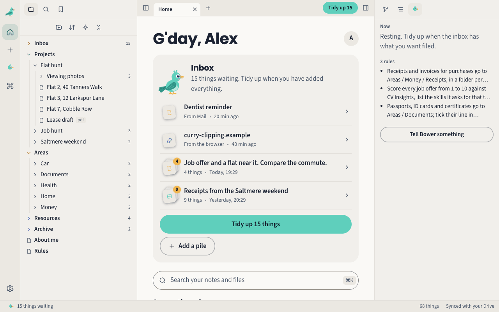
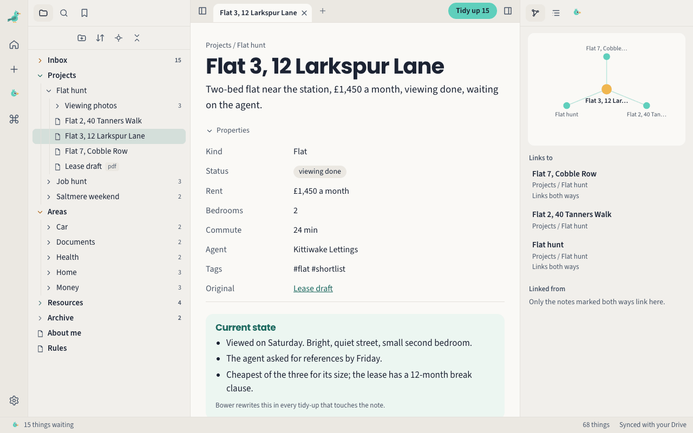
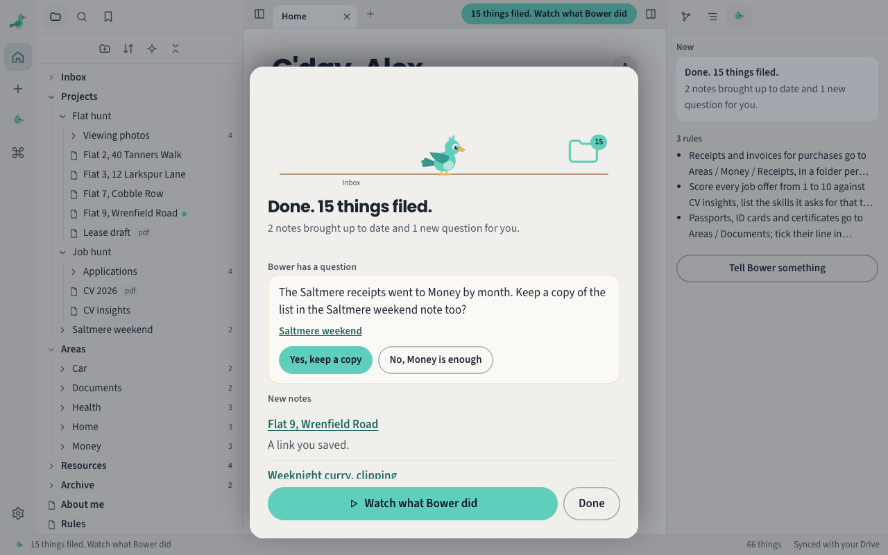
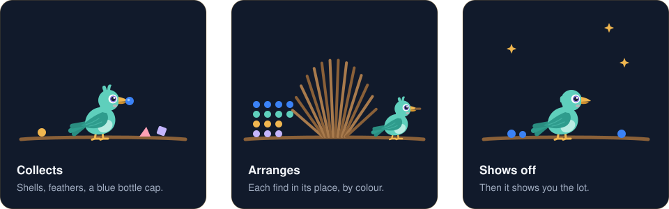
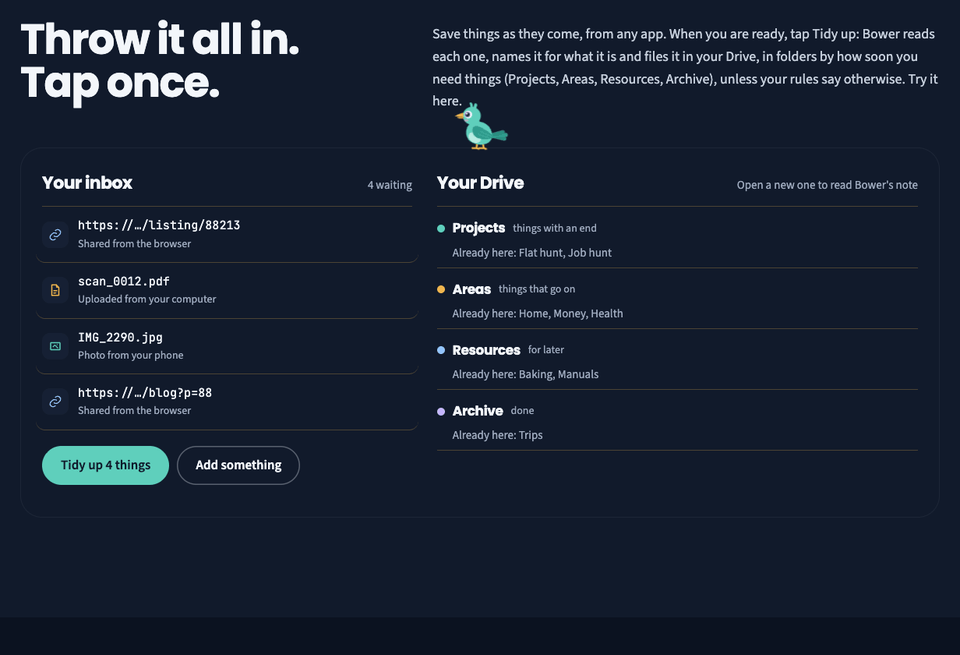
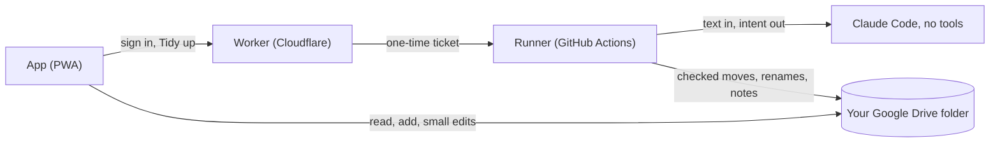

<p align="center">
  
</p>

<p align="center"><b>Throw it all in, tap <em>Tidy up</em>, and Bower files it.</b><br>
A second brain that tidies itself, as plain Markdown and the original files, in your own Google Drive.</p>

<p align="center">
  <a href="https://github.com/deluispablo/bower/actions/workflows/gate.yml"></a>
  <a href="#license"></a>
  <a href="https://claude.com/claude-code"></a>
  
</p>

<table align="center">
  <tr>
    <td align="center" width="33%">
      <picture>
        <source media="(prefers-color-scheme: dark)" srcset="docs/readme/screens/home-desktop-dark.png">
        
      </picture><br><sub>Home</sub>
    </td>
    <td align="center" width="33%">
      <picture>
        <source media="(prefers-color-scheme: dark)" srcset="docs/readme/screens/note-desktop-dark.png">
        
      </picture><br><sub>A note</sub>
    </td>
    <td align="center" width="33%">
      <picture>
        <source media="(prefers-color-scheme: dark)" srcset="docs/readme/screens/report-desktop-dark.png">
        
      </picture><br><sub>After a tidy-up</sub>
    </td>
  </tr>
</table>

<p align="center"><sub>The local demo: Alex is made up, and so is everything in the folder. Light or dark follows your GitHub theme.</sub></p>

---

## Why a bowerbird

The male bowerbird of Australia and New Guinea spends his days collecting bright things (shells, feathers, flowers, the odd blue bottle cap), lays them out in front of a bower of twigs, sorted by colour, and then shows off the whole arrangement.

That is the job Bower does for your notes. It collects what you throw at it and keeps it tidy in a folder of your own Google Drive. You read it in the app, or in Obsidian on the same folder.

<p align="center"></p>

## What it does

- **Throw it all in.** Files, links or a line of text, from a phone or a computer. Things that belong together go in one pile with a sentence about them.
- **One tap tidies.** Each original moves to the folder your rules name, or where [PARA](https://fortelabs.com/blog/para/) says, with a name that says what it is. Nothing runs until you tap.
- **Notes that stay current.** A note keeps a *Current state* Bower rewrites as new things arrive, and links to related notes both ways.
- **Questions, not guesses.** Two listings that look like the same flat become a question on Home.
- **Tell Bower.** A request ("put my visa papers together") or a rule ("receipts go to Money, by month"), kept in your folder in your words.
- **Plain files, any app.** Markdown and the originals in one Drive folder. Nothing is ever hard-deleted, only moved to the Drive Bin.

Bower reads text, Markdown, saved links and PDFs with a text layer. Photos and scanned PDFs are not read yet, so give them a sentence in a pile and Bower files them by that.

<p align="center"></p>

## How it works

Four parts, each with one job. The **app** (`src/`, a React PWA) reads and adds straight to your Drive. The **Worker** (`api/`, on Cloudflare) keeps your sign-in and starts one tidy-up at a time. The **runner** (`runner/`) does the tidy-up on GitHub Actions: it reads the inbox, asks **Claude** (Claude Code in headless mode, with every tool turned off) where each thing goes and what the notes should say, checks the answer, then applies it to Drive. Claude proposes; plain code does every write, and each write checks the file is still as it read it. The mechanism map is in [`docs/ARCHITECTURE.md`](docs/ARCHITECTURE.md).



## Run your own

Bower is self-hosted: whoever runs it sets it up once, and the people they invite sign in with Google and get a folder in their own Drive. The full walkthrough is the [runbook](docs/runbook.md).

1. **Accounts.** Cloudflare, a Google Cloud project with an OAuth client, GitHub, and a Claude plan that includes Claude Code.
2. **The Worker.** Set its secrets with `wrangler secret put` and deploy it; it serves the app too.
3. **The instance repository.** `scripts/new-instance.sh OWNER/NAME <origin>` creates a private repository with the tidy-up workflow. Add `CLAUDE_CODE_OAUTH_TOKEN` as its secret and set the `BOWER_PROVIDER` variable to `claude`.
4. **Invite people.** Put each address on the Worker's allowlist; they sign in and Bower builds their folder.

Cloudflare's free plan, GitHub's free minutes (or your own machine) and each person's own Drive cost nothing; Claude runs on the plan of whoever runs the Bower.

## For developers

```bash
pnpm install
pnpm dev            # the demo with Alex's folder, at http://localhost:5190
pnpm check          # lint, types, unit tests, builds and the other static checks
pnpm e2e            # end-to-end on a pretend Drive, phone and desktop, with axe
pnpm test:affected  # unit tests affected by a change
```

A batch of changes is merged only after `scripts/ci-gate.sh sdd/batch-N` pushes the batch branch and the [`gate`](.github/workflows/gate.yml) workflow passes. Start with [the product](docs/PRODUCT.md) and the rules in [`CLAUDE.md`](CLAUDE.md).

## How it was built

Bower was designed and written by [Claude Code](https://claude.com/claude-code) agents working as an engineering team under **deluisp-sdd**, a spec-driven method for coding agents. A coordinator splits each idea into small tasks, each pinned by failing tests before work starts; a fresh worker implements it, another agent reviews it, and only the CI gate lets it in.

In 14 days (4 to 17 October 2026): 235 tasks closed, 6,373 commits, 409 unit test files and 68 end-to-end specs.

## License

Bower is [Fair Source](https://fair.io/): the code is public, and you may read it, run it, change it and share it, under the [Functional Source License 1.1, MIT Future License](LICENSE) (`FSL-1.1-MIT`).

- **Allowed:** running your own Bower for yourself, your household or your team, even at work; changing it; learning from it; helping someone else run theirs.
- **Not allowed:** offering Bower, or something substantially like it, as a competing product or service.
- **Two years later, fully open:** each version becomes MIT-licensed two years after it is published, with no restriction left.

The [LICENSE](LICENSE) file is what counts.

## Credits

Built by [deluispablo](https://github.com/deluispablo), with Claude Code doing the typing. Bower is drawn from the satin bowerbird, violet eye and blue bottle cap included, which really does collect, sort and show off.
